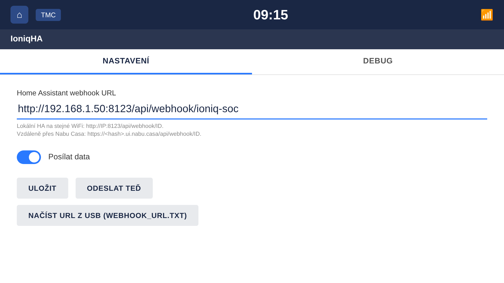
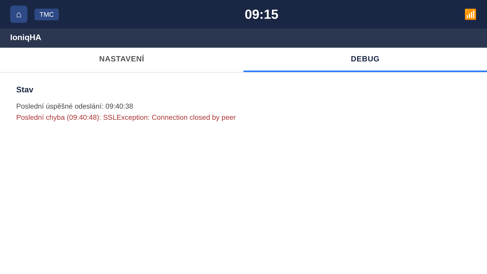

## Support

If IoniqHA is useful to you, you can [Buy me a coffee](https://github.com/sponsors/Bojkas1985) ☕

# IoniqHA

> ⚠️ **Disclaimer:** Jde o neoficiální, experimentální hobby projekt jednoho
> uživatele, nijak nesouvisející s Hyundai/Kia/LGE. Appka byla odladěná a
> otestovaná na jednom konkrétním autě/firmwaru (Hyundai Ioniq Electric
> 28kWh, LGE IVI head-unit) - na jiném roce výroby nebo jiné verzi
> softwaru nemusí fungovat vůbec, nebo může při startu spadnout. Appka
> jen čte data z vozidla, nic nezapisuje ani neovládá, ale používáš ji
> čistě na vlastní riziko a bez jakékoli záruky.
>
> *This is an unofficial, experimental hobby project by a single user,
> with no affiliation to Hyundai/Kia/LGE. The app was built and tested
> against one specific car/firmware (Hyundai Ioniq Electric 28kWh, LGE IVI
> head unit) - it may not work, or may crash on startup, on a different
> model year or software version. The app only reads vehicle data, it
> never writes to or controls anything, but it is provided as-is, use at
> your own risk.*

Minimalistická appka pro head-unit Hyundai Ioniq Electric (28kWh), inspirovaná
projektem [ABRPTransmitter](https://github.com/g4rb4g3/ABRPTransmitter) od
g4rb4g3. Místo posílání dat do ABRP posílá SoC (a pár dalších hodnot) rovnou
do Home Assistanta přes webhook. Žádný OBD dongle, žádný telefon, žádné ABRP
konto - čte přímo z LGE IVI frameworku, co už běží na head-unitu.

*A minimalist app for the Hyundai Ioniq Electric (28kWh) head unit, inspired
by [ABRPTransmitter](https://github.com/g4rb4g3/ABRPTransmitter) by g4rb4g3.
Instead of sending data to ABRP, it posts SoC (and a few other values)
straight to Home Assistant via a webhook. No OBD dongle, no phone, no ABRP
account required - it reads directly from the LGE IVI framework already
running on the head unit.*

**Appka je hotová a funkční** - úspěšně otestovaná v reálném autě, čte a
posílá reálná data (SoC, rychlost, nabíjení, teplota, výkon, dojezd,
nájezd a další) do Home Assistanta na lokální WiFi síti. Zkompilovaný
`.apk` ke stažení najdeš ve složce [`releases/`](releases/) (nebo si ho
sestav sám podle návodu tamtéž).

*The app is finished and working - successfully tested in a real car,
reading and sending real data (SoC, speed, charging, temperature, power,
range, odometer and more) to Home Assistant over the local WiFi network.
A compiled `.apk` is available in the [`releases/`](releases/) folder (or
build it yourself following the instructions there).*

## Screenshoty appky / App screenshots

| Nastavení (CZ) / Settings (EN) | Debug (CZ) / Debug (EN) |
|---|---|
|  |  |

**CZ:** Záložka "Nastavení" - webhook URL, přepínač "Posílat data",
tlačítka "Uložit", "Odeslat teď" a "Načíst URL z USB". Záložka "Debug"
ukazuje čas posledního úspěšného odeslání a poslední chybu (včetně typu
výjimky), ať appku jde kontrolovat přímo na displeji auta bez notebooku a
`adb logcat`.

**EN:** The "Nastavení" (Settings) tab holds the webhook URL, the
"Posílat data" (Send data) toggle, and the "Uložit" (Save),
"Odeslat teď" (Send now) and "Načíst URL z USB" (Load URL from USB) buttons.
The "Debug" tab shows the last successful send time and the last error
(including the exception type), so the app can be checked right on the car's
display without a laptop or `adb logcat`.

*(Pozn.: appka nemá anglickou lokalizaci, UI je jen česky - screenshoty výše
jsou mírně zjednodušená rekonstrukce reálného vzhledu, ne přímý snímek
obrazovky z auta. / Note: the app has no English localization, the UI is
Czech-only - the screenshots above are a slightly simplified reconstruction
of the real look, not a direct screen capture from the car.)*

## Co appka posílá

Každých 5 vteřin (pokud je head-unit připojený na WiFi a v appce je zapnuté
"Posílat data") POSTuje na nastavený webhook JSON:

```json
{
  "utc": 1700000000,
  "soc": 67,
  "speed": 0,
  "is_charging": 1,
  "ext_temp": 4.5,
  "power": 1.2,
  "range_km": 145,
  "odometer_km": 48213,
  "lat": 50.08,
  "lon": 14.43,
  "elevation": 250,
  "heading": 180
}
```

`range_km` (dojezd) a `odometer_km` (nájezd) čteme ze stejného
`GreenCarManager` jako SoC, jen jsou o něco méně prověřené (inspirováno
projektem [IoniqDI](https://github.com/ayasystems/IoniqDI), který na
stejném frameworku ukazuje i tyhle hodnoty) - proto se čtou každá zvlášť a
chyba jedné nespadne na zbytek telemetrie. "Čas do plného nabití" jsme
záměrně vynechali - v době nabíjení appka/head-unit běžně spí bez
připojení, takže by ta hodnota stejně nikdy nedorazila do HA ve chvíli,
kdy by byla k něčemu.

`lat`/`lon`/`elevation`/`heading` se objeví, jen pokud mezitím přišel broadcast
s GPS pozicí z navigace vozu - pokud ne, klíče v JSONu prostě chybí.

## Než to půjde zkompilovat

V `app/externallibs/com.lge.ivi.jar` už je hotový kompilační "stub" pro
`GreenCarManager`, `CarInfoManager` a `HvacManager` - nemusíš nic tahat z
auta, je součástí tohoto repozitáře.

Jak vznikl, pro úplnost (nejsou v něm žádná skutečná data z auta, jen
prázdné metody se správnými názvy a typy):

1. Skutečný `com.lge.ivi.jar` na tomhle firmwaru (Android 4.2 / API 17) je
   sám o sobě skoro prázdný (jen `META-INF/MANIFEST.MF`, 313 bajtů) - kód
   je "vypečený" do `com.lge.ivi.odex` vedle něj. To je normální chování
   staršího Dalviku, ne chyba.
2. `com.lge.ivi.odex` (plus celá `/system/framework` jako bootclasspath
   pro rozkódování) jsme z auta vytáhli přes `adb pull` a nástrojem
   `baksmali` ho "deodexovali" zpět na čitelné signatury metod.
3. Z těch signatur (ne z hádání) vznikly tři malé Java třídy se stejnými
   názvy metod a stejnými návratovými typy, jaké firmware skutečně má -
   jen s prázdným tělem (`return 0;` apod.). Zkompilovaly se do
   `com.lge.ivi.jar`, který tu teď je.

Proč prázdné tělo stačí: `compileOnly` v `app/build.gradle` znamená, že se
tenhle jar vůbec nezabalí do výsledného APK - slouží jen k tomu, aby
kompilátor věděl, že ty metody existují a jaké mají typy. V běžícím APK na
head-unitu se za ně v runtime dosadí skutečná implementace, co už na autě
běží. Pokud bys appku stavěl na jiném head-unitu s jinou verzí firmwaru a
něco by seděl (jiné signatury metod), stačí tenhle postup zopakovat s
novým `.odex` - appka sama o sobě na to není vázaná.

## Instalace na head-unit (bez počítače, stejně jako ABRP appka)

Přesně to, co jsi dělal u ABRPTransmitteru - žádný `adb install` potřeba:

1. Zkopíruj `app-debug.apk` na USB flešku.
2. Pokud ještě nemáš zapnuté "Neznámé zdroje": `Nastavení → Informace o
   systému → Aktualizovat` → na skrytém numerickém poli zadej `1-4-7-Clear`
   → otevře se Engineering Mode → `Android Settings → Zabezpečení →
   Neznámé zdroje` (zaškrtnout). Pokud to tam ze dřívějška (z instalace ABRP
   appky) už zapnuté máš, přeskoč.
3. Zasuň flešku do head-unitu, otevři file manager (dostupný taky přes
   Engineering Mode → All Applications, nebo přímo v launcheru), najdi
   `app-debug.apk` a klepni na něj → Instalovat.

Appku nainstaluj VEDLE starého ABRPTransmitteru, neodinstalovávej ho ještě.
Appka se po dalším bootu head-unitu nastartuje sama (BOOT_COMPLETED startuje
službu, stejně jako u originálu). Nastavení appky otevřeš buď ikonou v
launcheru, nebo **trojklikem** tlačítka EV do 3 vteřin (schválně trojklik,
ne dvojklik jako originál - starý ABRPTransmitter má vlastní nezávislé
počítadlo na dvojklik, takže cestou ke 3. stisku se jednou mihne i jeho
okno, ale naše appka se spolehlivě otevře na 3. stisku bez ohledu na to).

Pokud by USB cesta z nějakého důvodu nefungovala, funguje i klasika přes
ADB z počítače - `adb connect <IP head-unitu>` a `adb install
app-debug.apk` dělá přesně to samé, jen o kousek pomaleji po síti.

Až ověříš, že nová appka spolehlivě posílá data, starý ABRPTransmitter buď
vypni (zůstane nainstalovaný, jen přestane reagovat na tlačítko):

```
adb shell pm disable g4rb4g3.at.abrptransmitter
```

nebo rovnou odinstaluj:

```
adb uninstall g4rb4g3.at.abrptransmitter
```

## Nastavení v appce

1. Otevři appku (ikona, nebo trojklik EV do 3 vteřin).
2. Do pole URL zadej adresu webhooku v Home Assistantu, např.:
   `http://192.168.1.50:8123/api/webhook/ioniq-soc`
3. Zapni přepínač "Posílat data" a ulož.

## Nastavení v Home Assistantu

Hotové je to v `homeassistant/ioniq_package.yaml` - stačí ho nakopírovat do
`packages/ioniq.yaml` (nebo kamkoli, odkud ho `!include`) a po restartu HA
budeš mít entity pojmenované `IoniqHA_...` (např. `sensor.ioniqha_soc`,
`sensor.ioniqha_speed`, `sensor.ioniqha_charging`, `sensor.ioniqha_ext_temp`,
`sensor.ioniqha_power`, `sensor.ioniqha_dojezd`, `sensor.ioniqha_najezd` a
dál nová pole níže) - přejmenováno 2026-11-17 z `ioniq_...`, ať je hned
poznat, že jde o appku IoniqHA, i kdybys měl v HA sensory i z jiného zdroje
týkající se auta. Webhook ID zůstává napevno `ioniq-soc` (přejmenování
entit si nevyžádalo změnu URL v appce) - musí sedět s URL, co zadáš v appce.

### Nová pole (doplněno 2026-11-17)

Kromě základních hodnot appka teď posílá i:

- **Fairly jistá** (odpovídají jasně pojmenovaným metodám):
  režim jízdy (`sensor.ioniqha_drive_mode`), průměrná a aktuální spotřeba
  (`sensor.ioniqha_avg_efficiency`, `sensor.ioniqha_used_efficiency`),
  limit nabíjení v % (`sensor.ioniqha_charge_limit`), doplňkový dojezd
  (`sensor.ioniqha_range_add`) a vnitřní teplota kabiny
  (`sensor.ioniqha_inner_temp`).
- **Nejistá** (appka je posílá, protože metoda v deodexovaném frameworku
  existuje, ale přesný význam/jednotky nejsou stoprocentně ověřené - proto
  mají v názvu "neověřeno"): `sensor.ioniqha_battery_level`,
  `sensor.ioniqha_battery_percent_alt`, `sensor.ioniqha_evse_fault`,
  `sensor.ioniqha_driving_lockout`. Dávej si pozor zejména u
  `battery_level`/`battery_percent_alt` - může to být jiná škála než SoC v
  %, nebo duplicitní čtení stejné hodnoty jiným interním zdrojem.

Všechno nové je stejně jako dojezd/nájezd čtené s vlastním try/catch, takže
pokud se některé pole u tvého vozidla nepodaří přečíst, zbytek telemetrie to
neovlivní - prostě ten atribut/sensor zůstane prázdný.

## Vzdálený přístup (Nabu Casa) - nefunguje

Nabu Casa (HTTPS) se vyzkoušet nepodařilo rozchodit - starý Android na
head-unitu (API 17) neumí spolehlivě TLS SNI, které Nabu Casa pro
směrování vyžaduje, takže spojení vždy padá. Případné budoucí řešení by
šlo cestou obyčejného HTTP (bez TLS) přes vlastní port forward/DDNS,
nebo přes jiný transport (např. relay přes telefon) - zatím neřešeno.

## "Debugger" v appce

Appka si teď pamatuje (v SharedPreferences, takže to přežije i restart
appky) čas posledního úspěšného odeslání a text poslední chyby - vidíš to
přímo na nastavovací obrazovce v appce, pod tlačítky. Tlačítko **"Odeslat
teď"** spustí okamžitý pokus o odeslání mimo pravidelný 5vteřinový
rozvrh, ať nemusíš čekat ani tahat notebook s `adb logcat`.

## Nahrání webhook URL z USB flešky

Přepisovat dlouhý `https://xxxxx.ui.nabu.casa/...` hash na dotykové
klávesnici v autě je otrava. Místo toho:

1. Na počítači si vytvoř textový soubor s názvem přesně `webhook_url.txt`
   a do něj napiš jen tu URL (jeden řádek, nic víc).
2. Ten soubor dej na USB flešku (klidně vedle `app-debug.apk`).
3. V appce klikni na **"Načíst URL z USB"** - appka flešku prohledá a
   pokud soubor najde, automaticky s ním vyplní pole URL (zbývá jen
   zaškrtnout "Posílat data" a dát Uložit).

Appka zkouší pár obvyklých míst, kam se USB na head-unitech bývá
připojené, a navíc krátké rekurzivní hledání - takže by to mělo najít
soubor bez ohledu na přesnou cestu mountu.

## Co v této v1 záměrně chybí (řešeno jako diskuze, ne jako bug)

- **Offline buffer** - když není WiFi, data se zahodí, neukládají se na
  pozdější odeslání.
- **Android Auto / telefon** - appka běží čistě na head-unitu, bez závislosti
  na telefonu. Za jízdy bez domácí WiFi/hotspotu z telefonu appka neodesílá
  nic (poloha se v appce drží v paměti, ale nikam neposílá, dokud není WiFi).
- **HTTPS s moderním TLS (Nabu Casa)** - vyzkoušeno a nefunguje spolehlivě,
  viz sekce "Vzdálený přístup (Nabu Casa)" výše včetně fungující náhrady
  přes obyčejné HTTP + DuckDNS.
